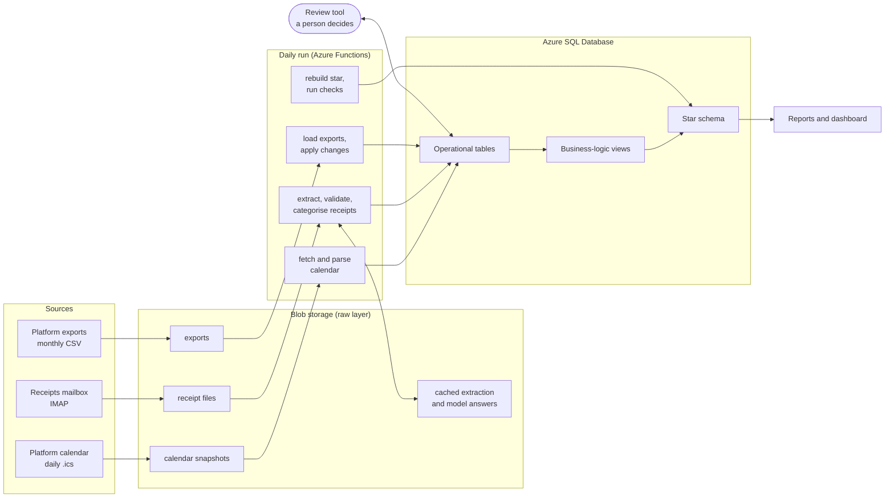

# Short-stay rental data platform (RedTree)


An end-to-end data platform for a short-term rental business, running on
Microsoft Azure. It ingests booking exports, a receipts mailbox and daily
calendar snapshots; turns receipts into categorised, validated expenses with
document AI, deterministic checks and two LLMs; and produces monthly profit
per listing, with shared costs apportioned, capital items spread and loan
interest accrued. Uncertain cases go to a human review loop.

The real business data stays private. Everything here builds and runs on
**generated demo data**, and CI builds the whole database from nothing and
tests it on every push.

## What it does

- **Bookings** from the platform's earnings and upcoming-payment exports:
  guests, bookings, payouts, and one row per night stayed.
- **Calendar change capture:** the listing's calendar is snapshotted daily;
  comparing consecutive snapshots detects new bookings, cancellations and
  changed dates, which the export alone never shows.
- **Receipts to expenses:** attachments from a mailbox are extracted with
  Azure AI Document Intelligence, validated (duplicates, arithmetic, dates,
  ABN check digits), categorised by two Claude models with schema-constrained
  answers, and routed to a listing by the address they were sent to. When the
  models disagree or a check fails, a person decides in a review tool; the
  decisions can teach merchant rules.
- **Honest monthly profit:** shared bills are split between listings by
  dated rules; capital items are spread over their life and period bills over
  the months they cover; loan interest is accrued by day; insourced cleaning
  carries an imputed cost.
- **A star schema** for analysis, loaded from the business-logic views and
  reconciled against them.
- **Automation:** one daily run in Azure Functions, secrets in Key Vault,
  infrastructure created by script.

## Architecture



Raw inputs are kept unchanged in blob storage, so every stage can be re-run.
Paid services (document extraction, LLM answers) are cached there too, keyed
by the exact request, so nothing is paid for twice and two databases get
identical answers.

## Quick start: the demo

Requirements: Python 3.11, Docker, and Microsoft ODBC Driver 18 for SQL Server.

```bash
# SQL Server 2022 in Docker
docker run -e ACCEPT_EULA=Y -e MSSQL_SA_PASSWORD='<a strong password>' \
    -p 1433:1433 --name sqlserver -d mcr.microsoft.com/mssql/server:2022-latest

# Create an empty database called RedTree, then:
pip install -r requirements-dev.txt
cp .env.example .env              # fill in the local SQL Server settings
pytest -q                         # unit tests
python3 python/build_db.py --demo --yes
```

`build_db.py --demo` builds the whole database from nothing: schema,
reference data, views, an example property, and a year of generated bookings,
expenses and loan interest, loaded through the real pipeline. Then it runs
every data-quality check, constraint test and scenario test. Then:

```sql
SELECT * FROM vw_monthly_report ORDER BY month_start;
```

## Using it for your own property

## The receipts mailbox (Gmail)

Receipts reach the pipeline by email: you forward a receipt (or a supplier
sends it) to a Gmail address, and the daily run reads it over IMAP. The
pipeline only reads: it never deletes, moves or marks messages as read.

1. **Create a Gmail account just for receipts.** Keeping it separate from
   your personal mail means the pipeline's access covers nothing else.
2. **Turn on 2-Step Verification** for that account (Google Account →
   Security). Google requires it before it will issue an app password.
3. **Create an app password** (Google Account → Security → App passwords),
   and name it after the project. It's a 16-character password used only by
   the pipeline, and you can revoke it at any time without changing the
   account's real password.
4. **Add both to your settings:** `GMAIL_USER` (the address) and
   `GMAIL_APP_PASSWORD` (the app password), in `.env` locally. In Azure, the
   app password goes into Key Vault, and `deploy/azure_setup.sh` copies it
   there from `.env`.

### One address per listing

Gmail delivers anything sent to `yourmailbox+anything@gmail.com` to the same
inbox, and the pipeline reads which address each email was sent to. So each
listing gets its own receipt address with no extra accounts:

- `yourmailbox+suite@gmail.com`: receipts for the listing with key `suite`
- `yourmailbox@gmail.com` (no tag): receipts for the default listing

Set each listing's address as `receipt_address` in `config/property.json`
(lower case), and mark one listing `default_for_receipts`. A bill for the
whole property can go to any of that property's listing addresses: the
categorisation decides whether it's for one listing or the whole property,
and the address says which property.

If you'd like to see each listing's receipts separately in Gmail, add a
filter per address that applies a label. The pipeline doesn't need it.

## Settings (.env)

Copy `.env.example` to `.env` (never committed) and fill in what you need:

| To... | Settings |
|---|---|
| build the demo | the local SQL Server (`MSSQL_*`) |
| run the pipeline | blob storage, Document Intelligence, the Anthropic API key, the Gmail mailbox and app password, and each listing's calendar URL (the setting named by `ical_url_setting` in your config) |
| use Azure SQL | the Azure database (`AZURE_MSSQL_*`) |

In Azure, the function app reads the same names from its app settings, with
secrets held in Key Vault; it never reads a `.env` file.

1. `python3 python/build_db.py --clean --yes`: schema and reference data only.
2. Copy `config/property.example.json` to `config/property.json` (kept out of
   git) and describe your property: listings, receipt addresses, apportionment
   rates, loans, merchant rules.
3. `python3 python/setup_property.py`: loads it, after checking it in full.
4. `python3 python/pipeline.py`: runs every step once.

For a new Azure deployment:

1. `deploy/azure_setup.sh`: the resources, one section at a time.
2. `python3 python/build_db.py --clean --azure --yes`: the schema. It refuses
   any database that already has tables, so it can never overwrite a live one.
3. `python3 python/setup_property.py azure`: your property, from your config.
4. `deploy/publish.sh`: the code, from an explicit file list, after the tests
   pass and a scan for secrets.
5. Upload your first exports to the exports container. The daily run does the
   rest.

## Project layout

| Folder | Contents |
|---|---|
| `sql/` | schema (`01`), reference data (`03`), views (`20`), checks (`30`, `31`, `63`), tests (`33`, `34`), transform and sync (`50` to `54`), star schema (`60` to `62`) |
| `python/` | the pipeline steps, `pipeline.py` (the daily run), `build_db.py`, `setup_property.py`, `review_receipts.py`, `make_demo_data.py` |
| `tests/` | unit tests for the decision-making functions |
| `config/` | the example property configuration |
| `deploy/` | Azure setup and publishing |
| `docs/` | the data model and design notes |

## The data model

About thirty tables in four areas, with diagrams in
[`docs/data-model.md`](docs/data-model.md). The choices worth knowing:

- **One row per night** (`STAY_NIGHT`) beside the booking's date range. The
  per-night grain makes `UNIQUE (listing_id, night_date)` prevent
  double-booking, a rule no `CHECK` constraint can express, and makes
  "revenue by month" a simple grouping.
- **History as events,** not a status column, because the interesting
  questions are about *when* a booking changed.
- **Every expense belongs to a property;** a composite foreign key makes it
  impossible to record a listing's expense against another property.
- **Rules as data:** apportionment rates, merchant rules and booking
  corrections are rows, loaded from a configuration file, not code.
- **Derive, don't store:** shares, spreading, accrued interest and calendar
  changes are views over what was recorded, so they can't drift from it.

## Key definitions

- **Revenue:** the net payout, spread evenly over the nights stayed and
  counted in the month each night fell.
- **Operating profit:** revenue − the listing's share of expenses (spread
  and apportioned) − cleaning costs.
- **Profit after interest:** operating profit − the listing's share of the
  property's loan interest, from the month it was listed.

Reports flag months whose revenue or interest isn't complete yet, and show how
much of the expenses no person has verified.

## Data quality and testing

- **Constraints for what is impossible, assertions for what is suspicious.**
  A check-out before check-in is a `CHECK`; stock going negative is an
  assertion, because consumption is estimated between stocktakes.
- **Constraint tests** (`33`): each one is valid except for the single fault
  under test, and passes only if the error names the expected constraint.
- **Scenario tests** (`34`): made-up calendar snapshots with one change of
  each kind, compared with the expected detections.
- **Unit tests** for the functions that make decisions: ABN checks, date
  parsing, rule resolution, validation of model answers, configuration checks.
- **CI** runs the unit tests, then builds the database from nothing with demo
  data and runs every check and test, on every push.

## Demo data and privacy

The demo data is generated at build time from a profile of the real
business's patterns (seasonality, stay lengths, cost categories), blurred
before publication: money scaled by an undisclosed factor, values rounded, a
different year. No real booking, guest, supplier or amount appears in this
repository.

## Roadmap

- **Dashboard** (Power BI) on the star schema, which becomes the single
  presentation layer, loaded from the views.
- **Inventory from receipts:** purchase line items become stock movements;
  consumption is estimated per stay and corrected by stocktakes.
- **Maintenance from service reports:** documents classified as reports
  become maintenance records.
- **Booking notification emails,** for guest counts.
- **Failure alerts** from the daily run.


## Development

Designed and built by Adel Nikfarjam. Parts of the code were written with
AI coding assistants (Claude, Claude Code) under my direction; I reviewed,
debugged and tested all of it. See
[`docs/DESIGN.md`](docs/DESIGN.md) for the main design decisions and the
reasoning behind them.

## Licence

This project is source-available under the
[PolyForm Strict License 1.0.0](LICENSE): you may build and run it for any
noncommercial purpose, but not change, redistribute or use it commercially.

As an additional permission, anyone may clone, build and run this project,
including the demo, to evaluate it, for example as part of a hiring process.

For any other use, please contact me.