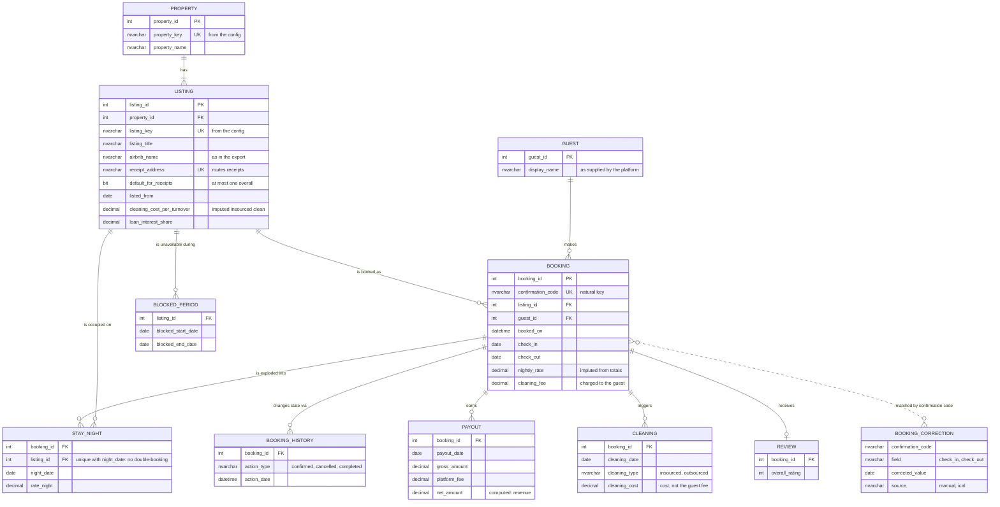
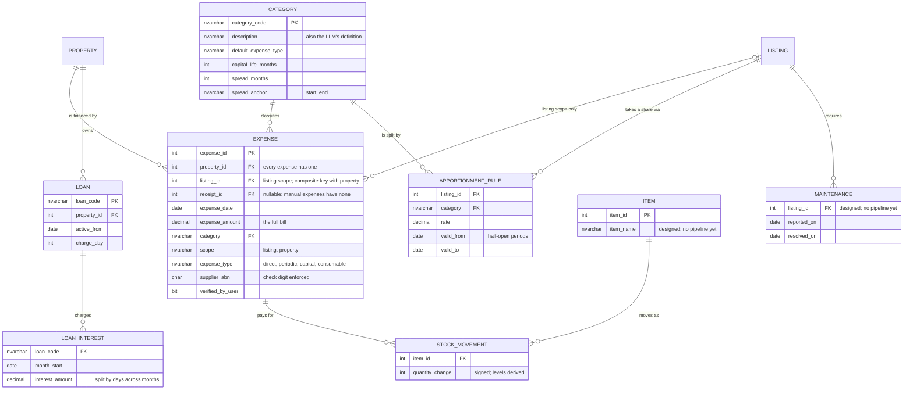
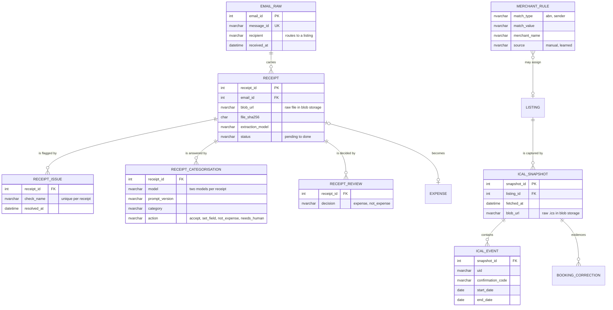
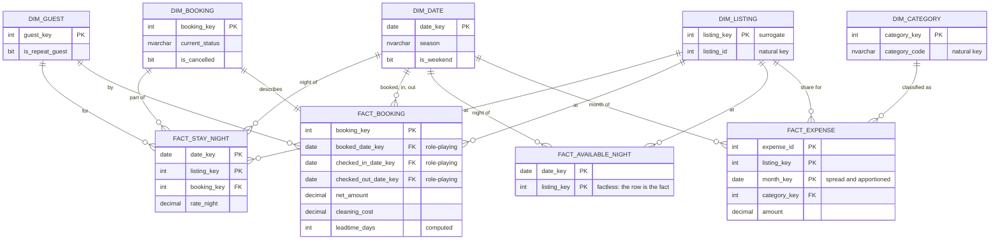

# Data model

About thirty tables in four areas, shown as four diagrams so each stays
readable. Key columns only; the full definitions are in `sql/01_schema.sql`
and `sql/60_star_schema.sql`.

## 1. Bookings and revenue

## 2. Costs: expenses, apportionment and loans

## 3. Ingestion: receipts and calendar snapshots

## 4. The star schema (presentation layer)

Strictly derived: rebuilt from the operational tables and views on every
load, and reconciled against them.

## Grain

| Table | One row is |
|---|---|
| `BOOKING` | one reservation, by confirmation code |
| `STAY_NIGHT` | one night of one booking at one listing |
| `PAYOUT` | one payment from the platform for a booking |
| `EXPENSE` | one bill or purchase, at its full amount |
| `APPORTIONMENT_RULE` | one listing's share of one category, for one period |
| `LOAN_INTEREST` | one loan's interest charge for one month |
| `RECEIPT` | one attachment from one email |
| `RECEIPT_CATEGORISATION` | one model's answer for one receipt and prompt version |
| `ICAL_EVENT` | one calendar event in one snapshot |
| `FACT_STAY_NIGHT` | one night, per listing, per booking |
| `FACT_BOOKING` | one booking |
| `FACT_AVAILABLE_NIGHT` | one bookable night, per listing |
| `FACT_EXPENSE` | one expense's share, per listing, per month |